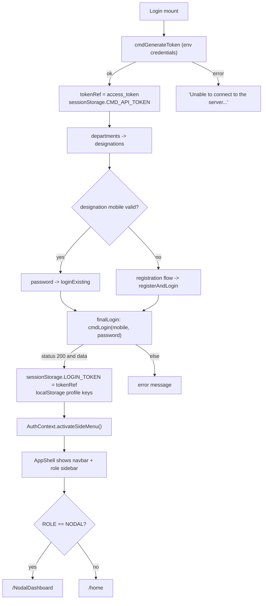
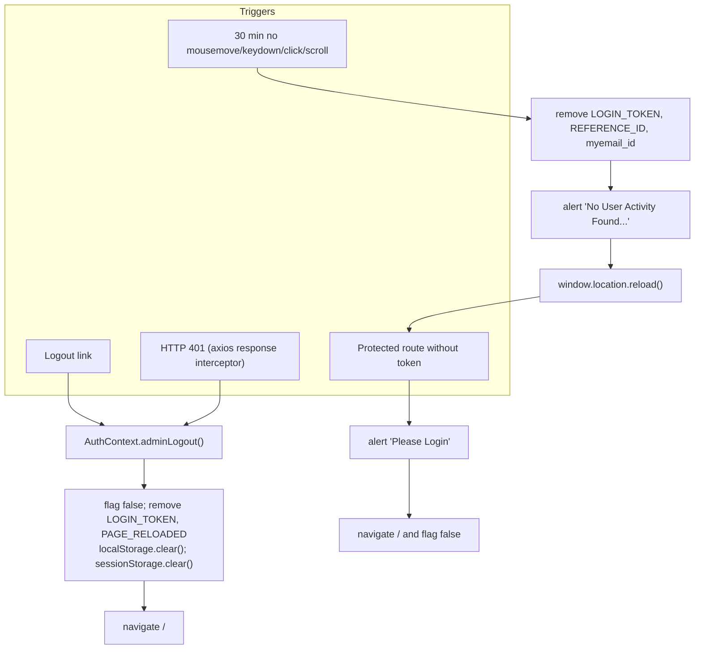
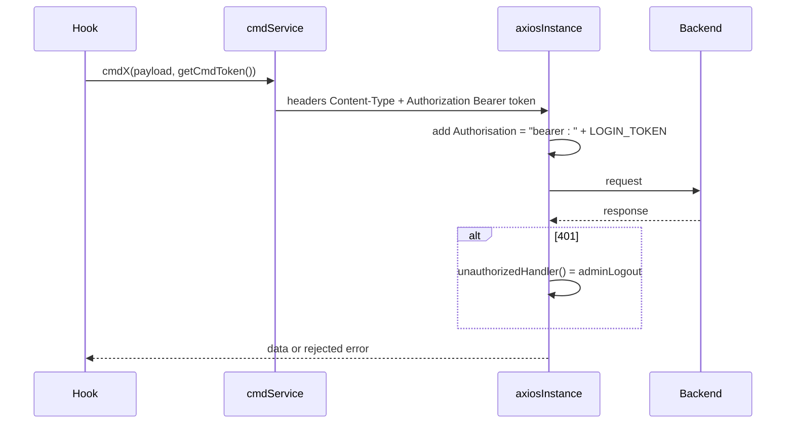

# 04 — Authentication and Session Management

Related: [09_AUTHENTICATION_AND_SECURITY.md](../09_AUTHENTICATION_AND_SECURITY.md). Registration and reset details: [08_business_workflows.md](08_business_workflows.md).

## Login and session start

## Session end

## Every request

