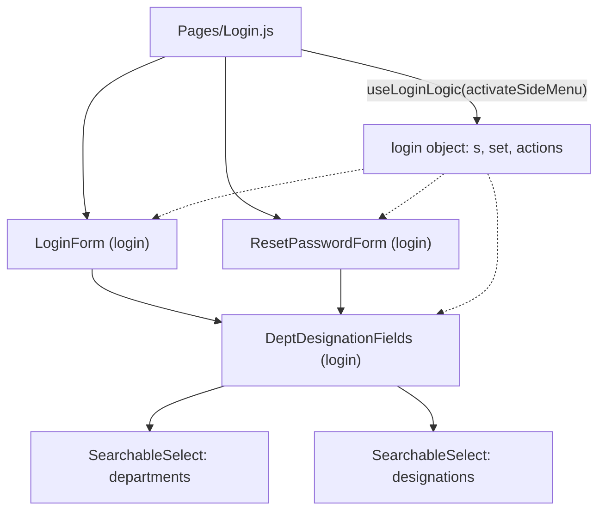
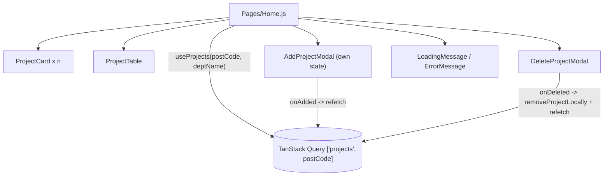
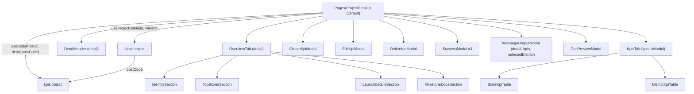
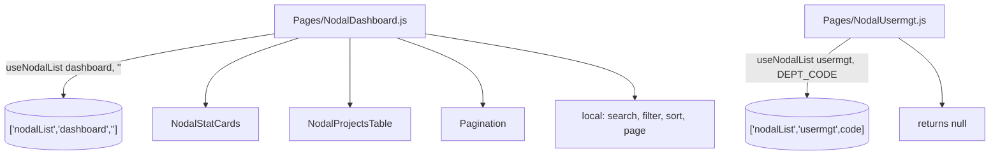
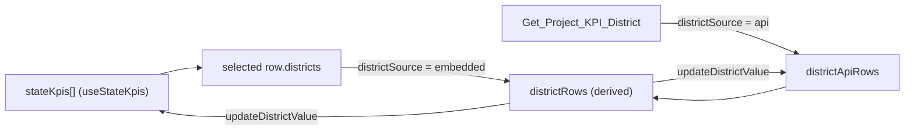

# 06 — Component Relationships and State Flow

Related: [04_COMPONENT_DOCUMENTATION.md](../04_COMPONENT_DOCUMENTATION.md), [07_STATE_MANAGEMENT_AND_DATA_FLOW.md](../07_STATE_MANAGEMENT_AND_DATA_FLOW.md)

## Login

## Home

## Project detail

## Nodal

## District value ownership

