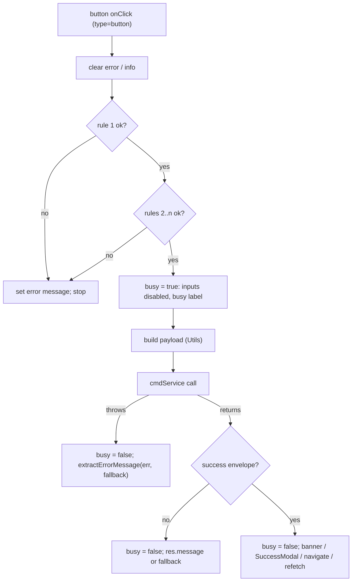
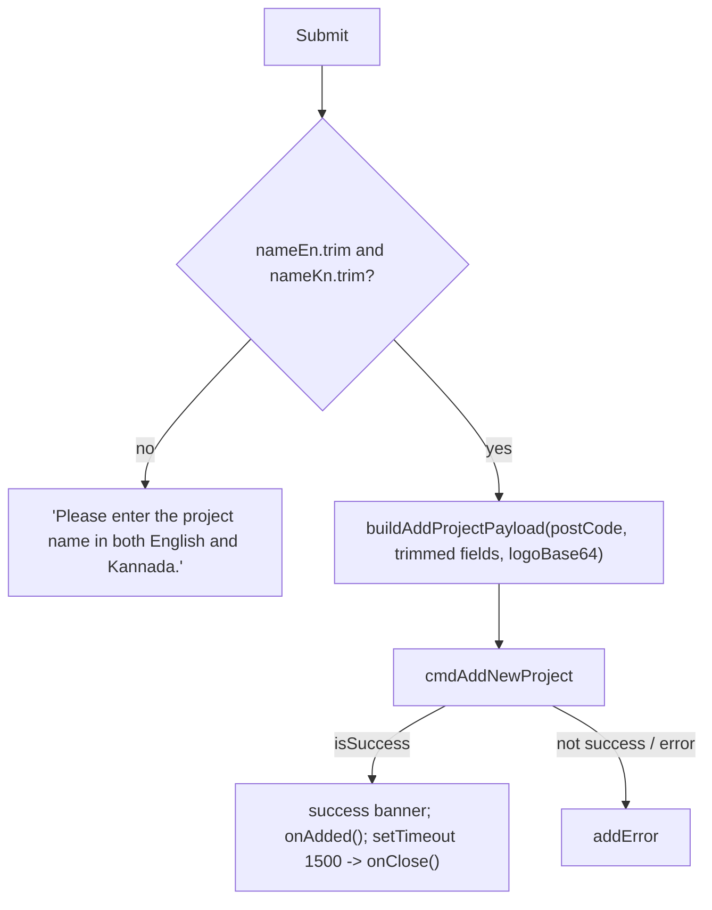
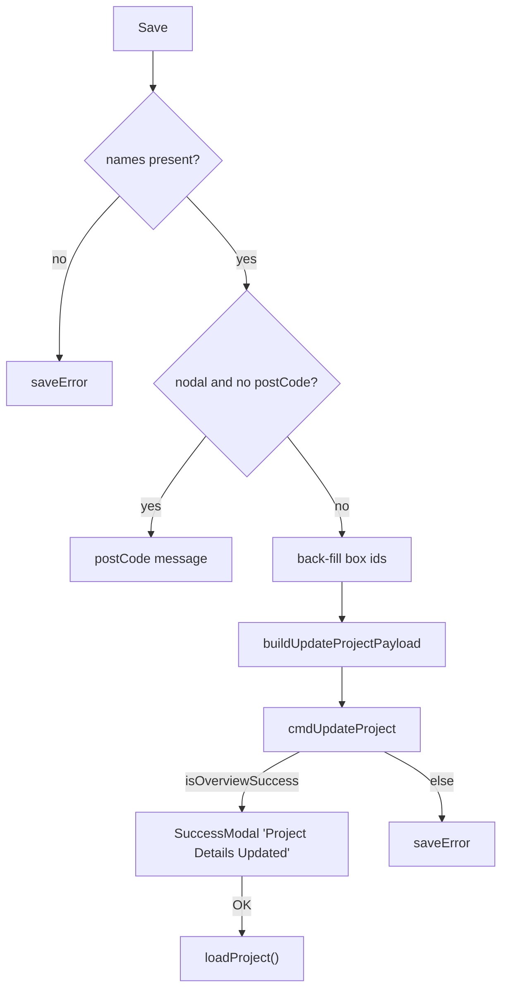
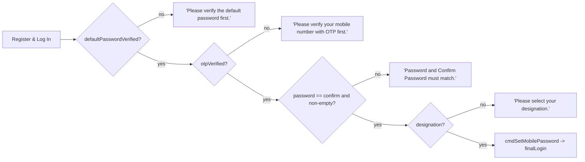
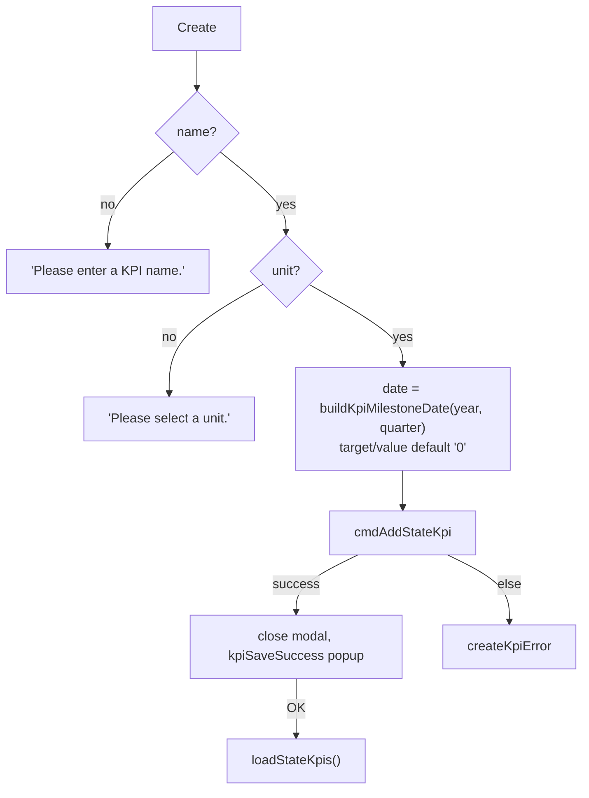

# 07 — Form Validation and Submission

Related: [08_FORMS_AND_VALIDATIONS.md](../08_FORMS_AND_VALIDATIONS.md)

## Common pattern

## Add Project modal

## Project overview Save

## Registration sequence guard

## KPI create

