# 08 — Business Workflows

One diagram per workflow. Related: [11_BUSINESS_LOGIC_AND_WORKFLOWS.md](../11_BUSINESS_LOGIC_AND_WORKFLOWS.md). Function names refer to the hooks in `src/Hooks/`.

## W1 Login (returning user)

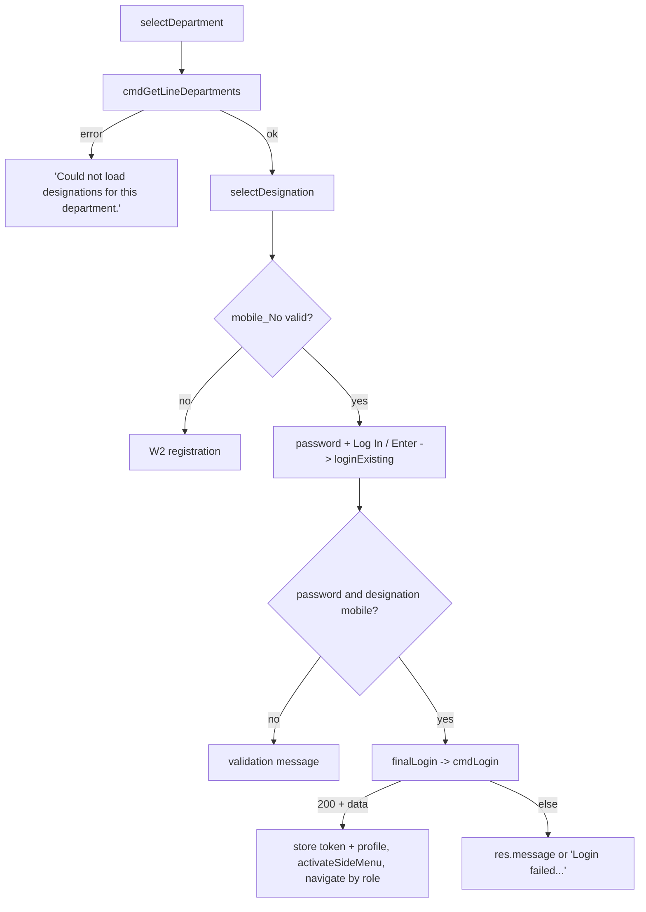

## W2 Registration

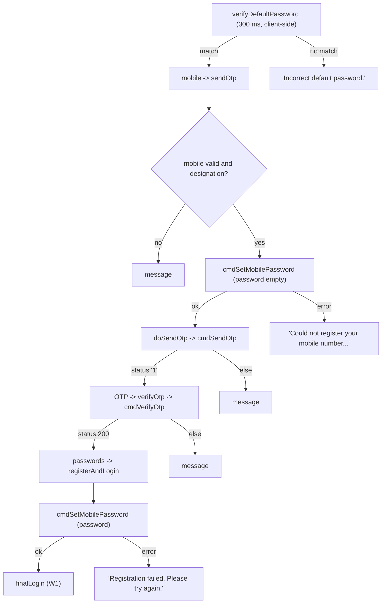

## W3 Reset password

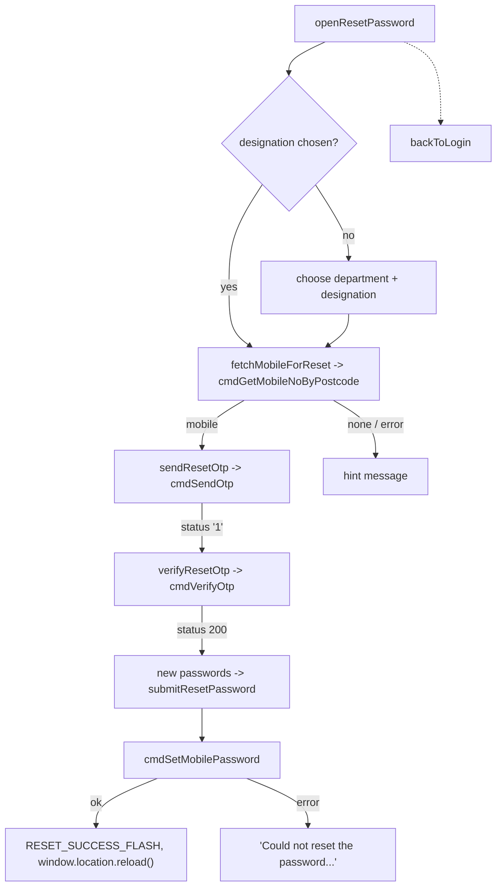

## W4 Project list

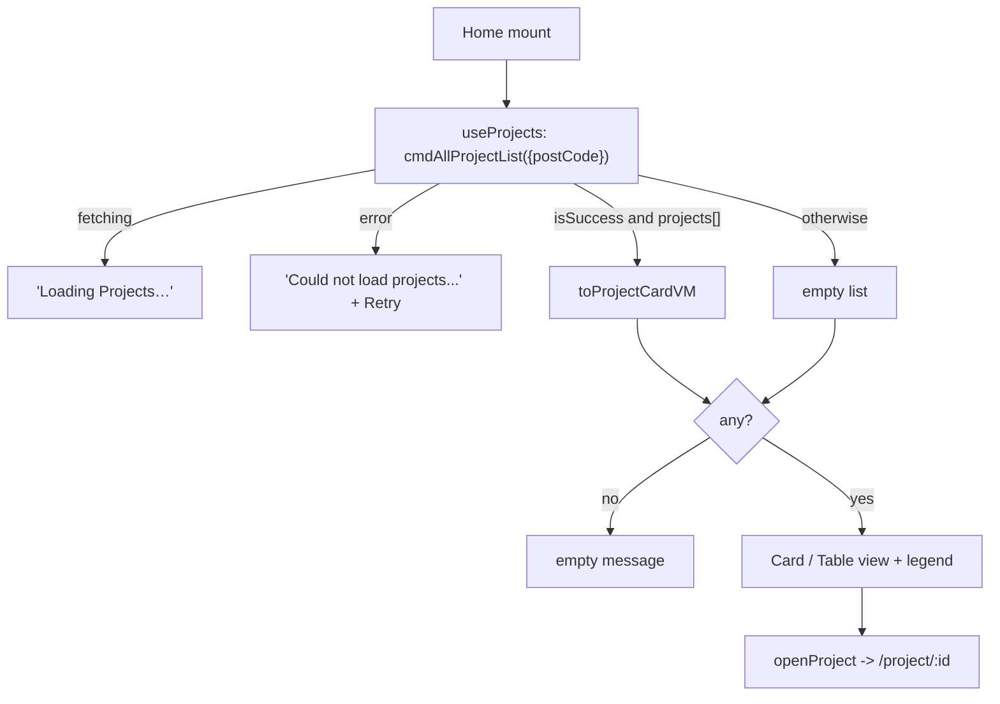

## W5 Add project

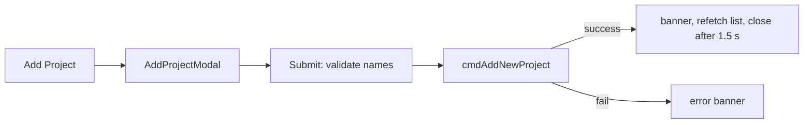

## W6 Delete project

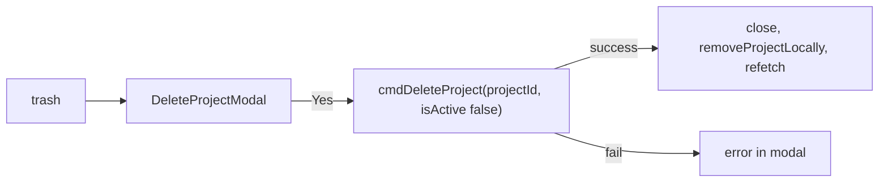

## W7 Overview load and save

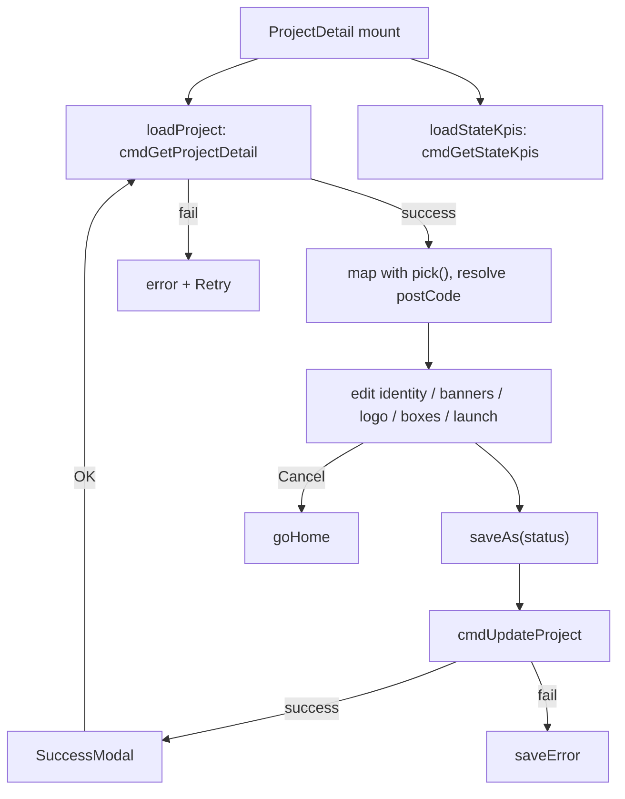

## W8 Change status

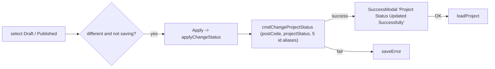

## W9 Milestone documents

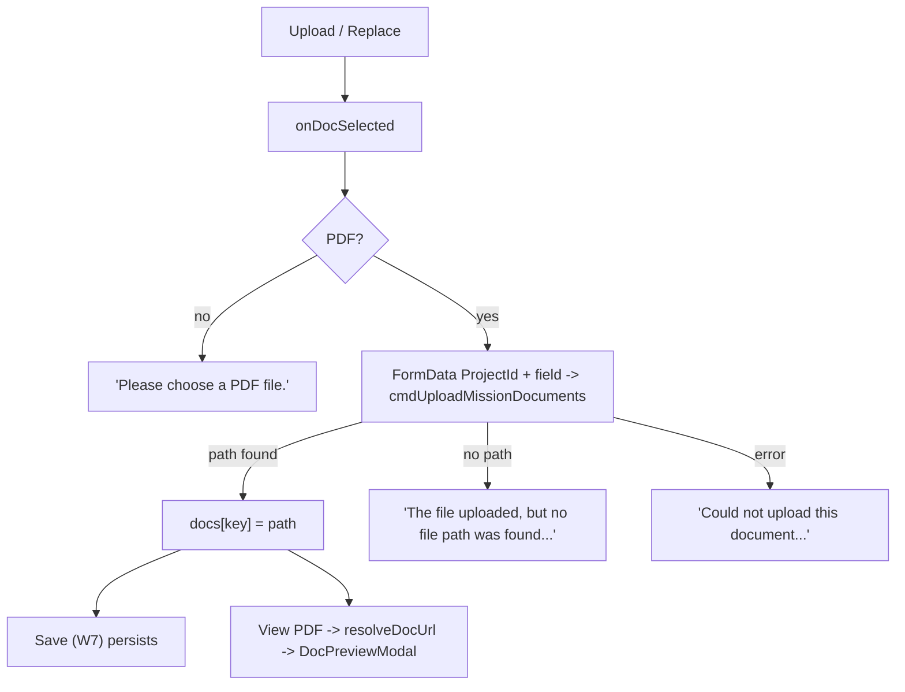

## W10 State KPIs

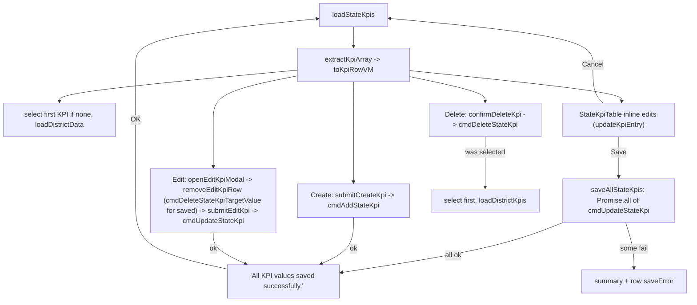

## W11 District KPIs

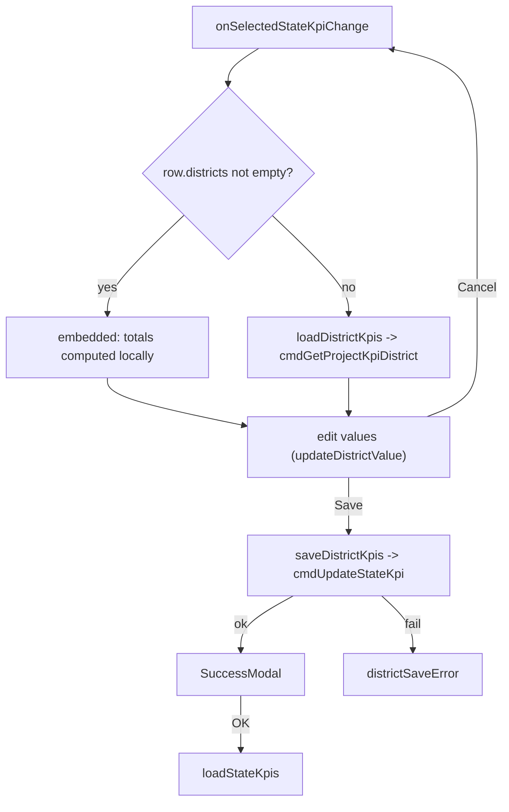

## W12 Webpage Output preview

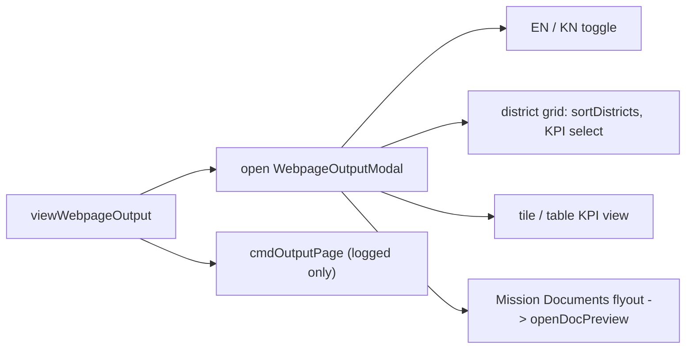

## W13 Nodal dashboard

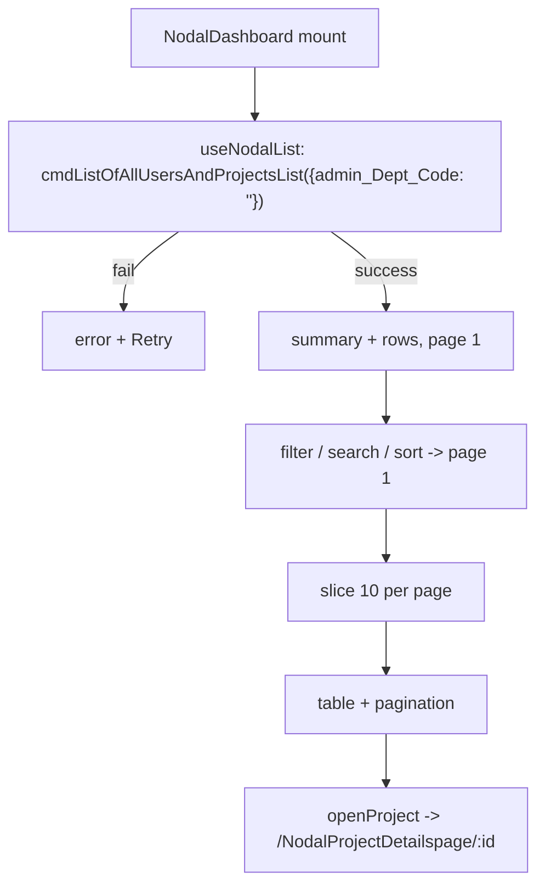

## W14 User Management

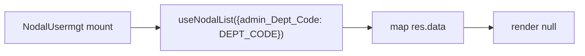
